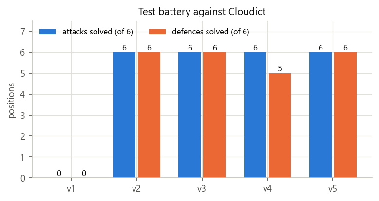
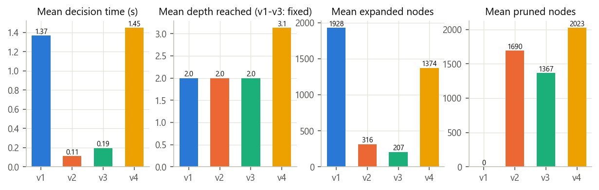
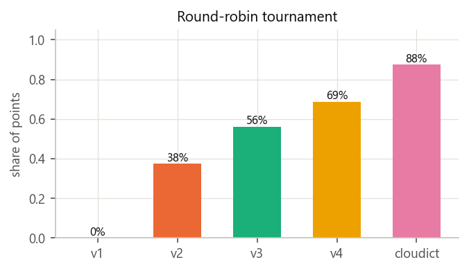
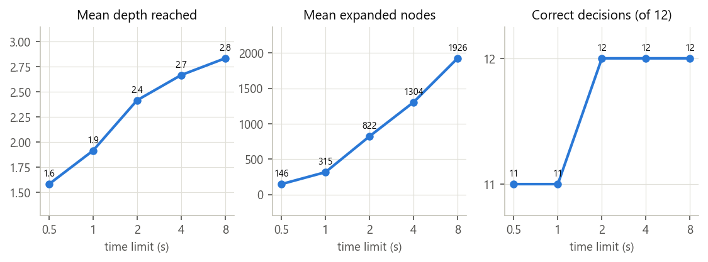
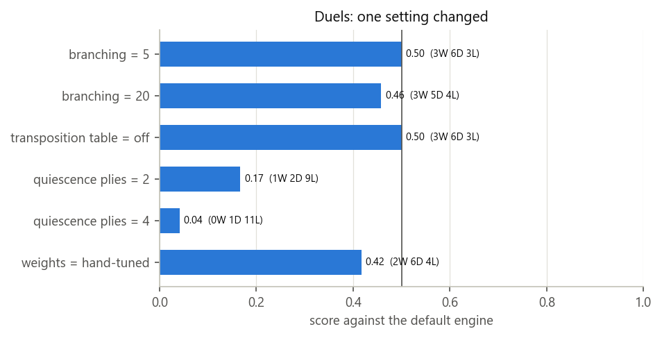
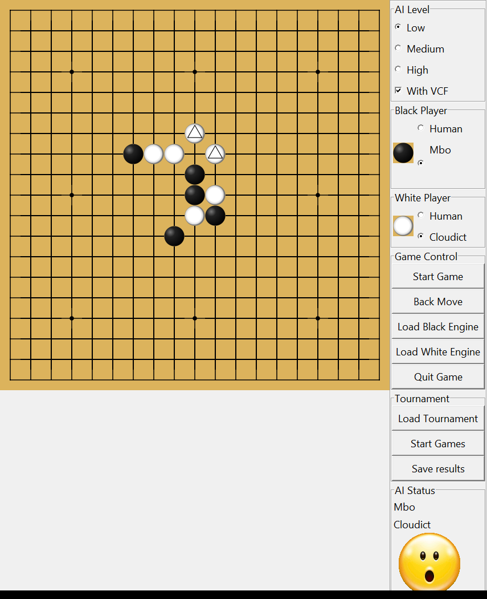
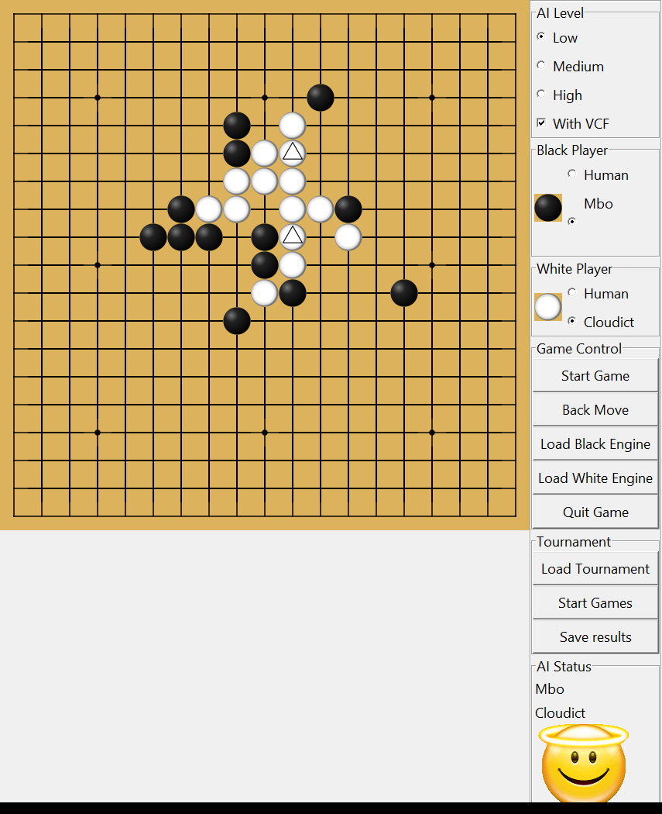

# Connect 6 Game Engine — Project Report

**Course:** Techniques in Artificial Intelligence, MSc in Artificial Intelligence, University of Alicante  
**Author:** Marius Botezatu (practice group 1, worked alone)  
**Engine name:** `mbo`  
**Date:** 6 November 2026  
**Repository:** <https://github.com/botezatumarius/Connect-6-Game-Engine>

## 1. Introduction

Connect6 is a two-player game played on a 19×19 Go board. Black places one stone on the first
move; after that, White and Black alternately place **two** stones per turn. The first player
with six or more stones in a row (horizontally, vertically or diagonally) wins, and the game is
a draw if the board fills up first.

The goal of this practice is a game engine that plays Connect6 with both colours from any
position, answers within a time limit, and communicates with the course GUI (ConnectMore)
through its text protocol. It must use the adversarial search algorithms of Unit 3 with
optimisations that make it work in real time, an evaluation function whose weights are tuned
with machine learning, and an experimental study of the effect of each decision.

The work followed the five sessions of the practice guide. The engine at the end of each
session was kept as a tagged version in Git, so that every stage could be measured in the
experiments:

| Version | Session | Main content |
|---|---|---|
| v1 | 1 | End-of-game detection, naive move proposal and evaluation, fixed-depth Minimax, protocol |
| v2 | 2 | Alpha-beta pruning, incremental board, threat-ranked move proposal, enhanced evaluation |
| v3 | 3 | Detection of imminent threats, weighted feature evaluation with hand-tuned weights |
| v4 | 4 | Weights evolved by a genetic algorithm, iterative deepening under a time limit, forward pruning, transposition table, quiescence search, opening book |
| v5 | 5 | Threat-space search, added after the experiments revealed a weakness (final version) |

Section 2 reviews the state of the art, Section 3 explains and justifies the development,
Section 4 presents the experiments of session 5, and Section 5 concludes.

## 2. State of the art

### 2.1 Connect6 and its complexity

This review is based on the two documents suggested in Moodle, Wu and Huang's paper that
introduced the game [2] and Liu and Lin's work on defence and threat-space search [13, 14],
together with the references they cite.

Wu and Huang introduced Connect6 in 2005 as a member of the family of *k-in-a-row* games
Connect(m, n, k, p, q): an m×n board, k stones in a row to win, p stones per move and q stones on
the first move [1, 2]. Connect6 is Connect(19, 19, 6, 2, 1). They argue that p = 2q is a
necessary condition for fairness: then, after every move, the player who has just moved has
exactly q stones more than the other, so neither side keeps a permanent advantage of tempo,
unlike Gomoku (Connect(15, 15, 5, 1, 1)), where the first player is known to win [3]. Since 2006
Connect6 has been a tournament of the ICGA Computer Olympiad [13].

The game is very large. Each of the 361 intersections is empty, black or white, so there are at
most 3³⁶¹ ≈ 10¹⁷² states, the same order as Go. The branching factor is far larger than Go's:
with about 300 empty cells, a two-stone move has about 300·299/2 ≈ 45,000 choices. A full-width
search is therefore impossible, and every successful program restricts the moves it considers.
Fortunately, Connect6 has **high locality** [14]: moves placed far from the stones already on
the board ("breakaway" moves) rarely help, because they give the opponent the initiative. Wu and
Huang showed, for instance, that if white answers black's first stone far away, black is in a
local Connect(6, 2, 3) game, which they proved to be a first-player win [2]. Programs therefore
consider only cells near the existing stones.

### 2.2 Threats: the central concept

Strong Connect6 programs reason in terms of **threats**. Wu and Huang [2] define them precisely
(their Definition 1): a player has *t* threats when the opponent needs to place *t* stones to
stop the player from winning on the next move. Because a player places two stones per turn, a
window of six cells that holds four or five stones of one player and no opposing stone can be
completed in one move. Consequences used throughout this engine:

- One threat (or two) can be answered: the defender uses one (or both) of its stones to block.
- **Three or more threats cannot be answered with two stones: the attacker wins.**
- A move creating two threats forces the opponent to spend its whole turn defending, so the
  attacker keeps the initiative. Chaining such moves until three threats appear is the basis of
  *threat-space search* [3, 13], called "victory by continuous double threat" in Connect6.

To count threats on one line, Wu and Huang slide a window of six cells along it; each window with
at least four of the player's stones, no opposing stone and no square marked yet adds one threat
and marks its rightmost empty square. They prove that this greedy count is exact for a line and
that one stone adds at most two threats to a line. They also name the patterns that become
threats with one more move: a line has a *live-l* (*dead-l*) threat if adding 4 − l stones
creates two threats (one threat), e.g. live-3, dead-3, live-2 and dead-2. These matter because a
two-stone move can turn them into real threats.

Allis et al. [3] introduced threat-space search to solve Gomoku, and Wu and Huang proposed its
Connect6 version, which became the basis of Connect6 programs [13]. Wu and Lin [4] later adapted
proof search to Connect6 with *relevance zones*, the regions where the defender's stones can
affect an attack. The ConnectMore GUI used in this practice comes with Cloudict [5], an
alpha-beta engine with a "victory by continuous four" (VCF) threat search, which serves as our
reference opponent.

### 2.3 Evaluation of Connect6 positions

Since the search cannot reach the end of the game, positions are scored statically. The usual
approach counts **windows** (Liu and Lin call them *potential lines*): every segment of six
consecutive cells is a possible winning line. A window containing stones of only one player is
*live* for that player, and a window with stones of both players is *dead*. Most programs are
pattern-based [13]: they assign a score to each configuration of stones on a line (the live and
dead threats above), often growing exponentially with the number of stones, and add the scores of
the four directions. The guide of this practice asks for the same two aspects: the size of each
live set and the number of stones the opponent needs to kill it.

Liu and Lin [13, 14] propose a more strategic scheme based on the *influence* of a stone: every
potential line through a stone (at most 11 cells in each of the four directions, cut by the
border or an opposing stone) gains value, stones closer to it weigh more than distant ones and
empty cells also have a small weight. Values along a line are multiplied (connectivity) and the
four directions are added (liberty). Two moves that create the same threat pattern can then be
told apart by the space around them.

The weights of a linear evaluation function, Σ wᵢ·fᵢ(s), are difficult to set by hand (Unit
3.3); Liu and Lin, for example, tuned theirs by experiment and experience. Machine learning can
set them instead: evolutionary methods [6] (Unit 4), regression on game outcomes, or, in recent
programs, neural networks trained by reinforcement learning.

### 2.4 Search algorithms and optimisations

Minimax and its pruned version, alpha-beta [7], are the classical algorithms for two-player,
zero-sum games with perfect information [11] (Unit 3.2 [12]). Alpha-beta returns the Minimax value while
examining far fewer nodes; its efficiency depends on the order in which moves are tried. The
optimisations of Unit 3.3 address the real-time constraint of game engines:

- **Iterative deepening:** searching depth 1, 2, 3… gives a move whenever time runs out, and each
  iteration orders the next one.
- **Forward pruning (N-best selective search):** only the N most promising moves, ranked by the
  static evaluation, are searched. This is risky but essential with a branching factor of 45,000.
- **Transposition tables with Zobrist hashing** [8]: the same position, reached by different move
  orders, is searched once. Connect6 has many transpositions, since the two stones of a move,
  and the moves of a sequence, can be placed in any order.
- **Quiescence search:** positions are evaluated only when they are quiet, which avoids the
  horizon effect.
- **History heuristic** [9] and **opening books.**

Monte-Carlo Tree Search [10] has also been applied to k-in-a-row games, but random playouts are
weak at the precise tactics (threats) that decide Connect6, so the strongest programs combine
search with threat-based knowledge.

### 2.5 Defence verified by threat-space search

Liu and Lin [13, 14] built a strong program, Kagami (fourth at the 14th Computer Olympiad, 2009),
around a defensive idea. A greedy defensive strategy, without search, considers only the cells of
the 5×5 squares around the opponent's last two stones and plays the best ones by the influence
evaluation; it drew all 10 games against NCTU6 (level 3) and 6 of 10 against X6, both Olympiad
champions. Its weakness, a defence that fails against a threat sequence, was removed by using
threat-space search as a **verifier**: if the chosen defensive move still lets the opponent win
by threats, the next moves of the list are tried until one holds, and a winning threat sequence
of our own, when found, is played at once. With this combination it drew all 10 games against X6
and beat MeinStein (silver medallist) 6–4. To keep the search cheap they use *conservative
defence* (all the defending stones of a threat are placed at once, which turns the search into a
single-agent search but can miss some wins) and a table of precomputed line patterns.

## 3. Development

This section follows the practice guide item by item. For every item it states what the guide
asks for, what was implemented and where (module and function), how it works, why it was done
that way, and how it was checked. Table 1 maps the items to the code.

| Session | Guide item | Implementation | Section |
|---|---|---|---|
| 1 | End of the game | `rules.py` (v1); `Board.put()`, `Board.is_full()` (final) | 3.2.1 |
| 1 | Naive proposal of next moves | `move_generator.candidate_cells()` (v1) | 3.2.2 |
| 1 | Naive static evaluation | `evaluation.count_living_sets()` (v1) | 3.2.3 |
| 1 | Naive search tree (Minimax) | `SearchEngine.minimax()` (v1) | 3.2.4 |
| 1 | API of the engine | `game_engine.py`, `tools.py` | 3.2.5 |
| 2 | Alpha-beta pruning | `SearchEngine.alpha_beta()` (v2), `negamax()` (final) | 3.3.1 |
| 2 | (support) Incremental board | `board.py` | 3.3.2 |
| 2 | Improved next-moves proposal | `move_generator.rank_cells()` | 3.3.3 |
| 2 | Enhanced static evaluation | `Board.blockers()`, `evaluation.py` (v2) | 3.3.4 |
| 3 | Review of the state of the art | Section 2 | 3.4.1 |
| 3 | Detection of imminent threats | `move_generator.generate_moves()` | 3.4.2 |
| 3 | Our own evaluation function | `evaluation.features()`, `evaluate()` | 3.4.3 |
| 4 | Weights optimised by machine learning | `training/genetic.py` | 3.5.1 |
| 4 | Answer within the time received | `SearchEngine.search()` | 3.5.2 |
| 4 | Forward pruning | `move_generator.rank_moves()`, `negamax()` | 3.5.3 |
| 4 | Transposition table, historical heuristics | `negamax()`, `Board.hash` | 3.5.4 |
| 4 | Quiescence search | `negamax()` | 3.5.5 |
| 4 | Opening book (with symmetries) | `opening_book.py`, `training/build_book.py` | 3.5.6 |
| 5 | Tests, and the improvement they led to | `threat_search.py`, `experiments/` | 3.6, 4 |

*Table 1: guide items and where they are implemented (v1 = code of session 1, later replaced).*

### 3.1 Starting point and architecture

The engine started from the course template (`Connect6Engine`). Its structure was kept (`main.py`,
`game_engine.py`, `search_engine.py`, `defines.py`, `tools.py`) and one module was added per
responsibility, so that each later session could replace one part without touching the others:

| Module | Responsibility |
|---|---|
| `main.py` | Entry point (also the PyInstaller target). |
| `game_engine.py` | Text protocol: reads commands, keeps the game, prints the answers. |
| `board.py` | Board, rules (win and draw), incremental window statistics, Zobrist hash. |
| `move_generator.py` | Candidate moves: wins, forced defences, ranked candidates. |
| `evaluation.py` | Weighted evaluation function and its features. |
| `search_engine.py` | Alpha-beta search with the optimisations of session 4. |
| `threat_search.py` | Threat-space search for forced wins (session 5). |
| `opening_book.py`, `book_moves.py` | Opening book, looked up through the board symmetries, and its data. |
| `tools.py`, `defines.py` | Move notation, printing, logging; constants. |

Each module depends only on the ones below it (`game_engine` → `search_engine` →
`move_generator`/`evaluation`/`threat_search` → `board` → `defines`). All the tunable values
(time shares, branching, table size…) are named constants in `defines.py`, and the search takes
its parameters in its constructor (`SearchEngine(weights, branching, table, quiescence)`), which
is what allowed the genetic algorithm and the experiments to run the same code with different
settings.

### 3.2 Session 1: a first functional engine

#### 3.2.1 Detecting the end of the game

*Requirement.* Detect whether the last move completed a row, column or diagonal of six stones of
one colour, and whether the board is full (a draw).

*Implementation (v1, `rules.py`).* The template's board is a 21×21 grid: the 19×19 board plus a
ring of `BORDER` cells. `count_run(board, x, y, dx, dy, color)` walks from a stone in one
direction while the cells hold the same colour; `is_winning_stone()` adds the runs of both
directions of each of the four axes (horizontal, vertical, two diagonals) plus the stone itself;
`is_win_by_premove()` applies it to the one or two stones of the last move;
`is_board_full()` looks for an empty cell in each row; and `get_game_result()` combines them
into `ONGOING`, `BLACK_WIN`, `WHITE_WIN` or `DRAW` (an enum whose win values equal the winner's
colour, so the winner is read directly from the stone).

*Why.* Only the last move can create a new line, because an earlier line would already have ended
the game, so checking its two stones is enough: a few steps instead of a scan of the board. The
border ring stops every walk without bounds checks. The rule says "six *or more*", so a line of
seven also wins. The template's version returned "no win" as soon as the first stone's cell was
empty, without checking the second stone; ours fixed that.

*Final version.* From session 2 the incremental board (3.3.2) knows how many stones of each
colour every six-cell window holds, so a win is detected when a window reaches six stones of one
colour (`Board.put()` sets `winner`), and a draw when the stone counter reaches 361
(`Board.is_full()`).

*Verification.* Ten hand-built cases: six in each of the four directions, five at the board edge
(no win), a win made by the second stone of a move, two groups joined into seven, a line broken
by an opponent stone, a full board without lines (draw) and an empty board.

#### 3.2.2 Naive proposal of next moves

*Requirement.* Propose the moves to explore; in the basic form the empty cells, limited to a
fixed number to avoid the combinatorial explosion.

*Implementation (v1, `move_generator.py`).* `candidate_cells()` visits every stone and records,
for each empty cell at Chebyshev distance ≤ 2 from it, its distance to the nearest stone. It keeps
the 10 nearest cells (`MAX_CANDIDATE_CELLS`) and `generate_moves()` pairs them with
`itertools.combinations`: at most 10·9/2 = 45 two-stone moves, instead of about 45,000 pairs of
empty cells. On an empty board the only move is black's single stone in the centre; if fewer than
two cells are near a stone (an almost full board), every empty cell is used, so a legal move
always exists.

*Why.* A move far from all stones almost never matters in Connect6 (its locality, Section 2.1),
so the empty cells near the stones are the natural "limited" set. Starting from the stones
(at most 25 cells each) is cheaper than measuring every empty cell against every stone.

*Verification.* Empty board → `JJ`; one centre stone → 45 distinct moves on empty cells within
distance 2; stones in the corners → no access outside the board; a full board with two far
empty cells → exactly that pair. It took 0.2–0.3 ms per call.

#### 3.2.3 Naive static evaluation

*Requirement.* Use the end-of-game function to return MAX (first player wins), 0 (draw) or MIN
(second player wins); otherwise a score proportional to the first player's advantage, for
example the number of sets of living stones.

*Implementation (v1, `evaluation.py`).* A finished game returns `MAXINT` (+20,000), 0 or
`MININT` (−20,000). Otherwise the score is the number of Black's *living sets* minus White's,
a living set being a window of six cells holding stones of only one colour. All 92 lines of the
board that are at least six cells long (rows, columns and diagonals) are computed once. At each
evaluation the board is flattened to bytes and each line is read with one `operator.itemgetter`
call, and its windows are counted by splitting it at the opponent's stones:

```python
def open_windows(line, blocker):
    """Count the windows of `line` with no `blocker` stone."""
    return sum(max(0, len(segment) - Defines.WIN_LENGTH + 1) for segment in line.split(blocker))


def count_living_sets(board):
    """Black's living sets minus White's (empty windows cancel out)."""
    flat = bytes(chain.from_iterable(board))
    score = 0
    for get_line in LINE_GETTERS:
        line = bytes(get_line(flat))
        score += open_windows(line, WHITE_STONE) - open_windows(line, BLACK_STONE)
    return score
```

*Why.* A segment of length L between opposing stones contains L − 5 windows without them. Windows
without white are Black's living sets plus the *empty* windows; windows without black are White's
plus the same empty windows, which therefore cancel in the difference. The splitting runs in C
(`bytes.split`), about twice as fast as sliding a window cell by cell (measured 0.26–0.30 ms
against 0.60–0.66 ms). Scores stay far from MAX/MIN, since there are only 924 windows.

*Verification.* Compared with a brute-force count of every window on 300 random boards: no
difference. One black stone in the centre scores +24, the number of windows through that cell.

#### 3.2.4 Naive search tree: Minimax

*Requirement.* Minimax without pruning, with a fixed depth at which the static evaluation is
returned.

*Implementation (v1, `search_engine.py`).* `best_for(color)` returns Python's `max` for Black and
`min` for White, so one recursive method serves both players:

```python
def score_move(self, move, depth, color):
    """Minimax value of playing `move` for `color`."""
    make_move(self.m_board, move, color)
    score = self.minimax(depth - 1, opponent(color), move)
    unmake_move(self.m_board, move)
    return score

def minimax(self, depth, color, preMove):
    """Minimax value of the position after `preMove`, with `color` to move."""
    self.m_total_nodes += 1
    if depth == 0 or get_game_result(self.m_board, preMove) != GameResult.ONGOING:
        return evaluate(self.m_board, preMove)
    return best_for(color)(self.score_move(move, depth, color)
                           for move in generate_moves(self.m_board))
```

The root scores every candidate the same way and plays the best one for its colour (the
highest score for Black, the lowest for White). The depth is 2 plies: our move and the reply.

*Why.* Black is MAX and White is MIN because the evaluation is from Black's point of view, as
the guide specifies. Moves are made and undone on one copy of the board instead of copying it
at every node. Depth 2 (≈ 2,000 positions) answered in about 0.5 s; depth 3 would need ≈ 91,000.

*Verification.* Compared with an independently written Minimax on 15 random positions: identical
values.

#### 3.2.5 API of the engine

*Requirement.* The commands of the template and the statement, so that the GUI can drive the
engine.

*Implementation (`game_engine.py`, `tools.py`).* `GameEngine.run()` reads one line at a time,
writes it to `mbo-engine.log`, splits it into command and argument, and calls the handler of the
command from a table (`m_commands`); `exit`/`quit` end the loop, and `vcf`, `unvcf` and unknown
commands have no handler, so they are ignored as required. After each command the output is
flushed, because the GUI reads through a pipe.

| Command | Handler and behaviour |
|---|---|
| `name` | `on_name()` prints `name mbo` (the name assigned by the professor, `Defines.ENGINE_NAME`). The GUI waits for this line when it loads the engine and shows "Mbo". |
| `print` | `print_board()`: the board with X (black) and O (white). |
| `exit`, `quit` | End the program. |
| `black XXXX`, `white XXXX` | `on_place()`: parse the cells with `msg2move()` and play them for that colour; the side to move becomes the other colour. |
| `next` | `on_next()`: search a move for the side to move, play it, print `move XXXX`. |
| `move XXXX` | `on_move()`: play the opponent's stones for the side to move, then do `next`. |
| `new black` / `new white` / `new xxx` | `on_new()`: empty board, black to move; with `black` the engine plays the first move at once. |
| `depth d` | `on_depth()`: time limit of *d* seconds per turn, capped at 25 s. |
| `vcf`, `unvcf` | Ignored. |
| `help` | Prints the list of commands. |

Two details of the GUI shaped this design. First, every turn the GUI sends `new xxx`, the *whole*
history (`black JJJJ`, `white ASBS`, …) and `next`: the engine therefore never assumes a colour;
the side to move is always the opponent of the last colour placed, so it plays both colours from
any position. Black's first move arrives as `JJJJ` (the same cell twice); `msg2move()` removes
duplicates, so it becomes one stone. Second, `depth d` is used as the time limit, as the
statement says: the GUI levels Low, Medium and High send 4, 5 and 6 seconds, and the cap of 25 s
stays below the GUI's 30 s forfeit. Coordinates follow the GUI: the first letter is the row and
the second the column. The template printed single-stone moves with the letters swapped, which we
fixed.

*Verification.* Command sequences exactly like the GUI's (empty history, black's first move,
`new white` + `move`, `print`, unknown commands), and a whole game against Cloudict through a
driver that behaves like the GUI.

*Limitations found.* The naive engine lost to Cloudict in 8 turns. Tactical tests showed why:
with a four on the board it did not complete it, and it did not block an opposing four. The
search was correct (with 24 candidate cells it found the win, but needed 30–40 s per move); the
naive proposal ranked cells by distance and broke ties by board order, so the decisive cells
were never offered. This motivated the improved proposal of session 2.

### 3.3 Session 2: alpha-beta, threat-ranked moves and a better evaluation

#### 3.3.1 Alpha-beta pruning

*Requirement.* Add alpha-beta pruning to the Minimax implementation.

*Implementation (v2, `SearchEngine.alpha_beta()`).* The Minimax recursion of 3.2.4 received the
(α, β) window: α is the value MAX (Black) is already guaranteed, β the value MIN (White) is
guaranteed. The root is the call with `ply == 0`, which records the best move:

```python
maximizing = color == Defines.BLACK
moves = generate_moves(board)
for i, move in enumerate(moves):
    board.play(move, color)
    score = self.alpha_beta(depth - 1, alpha, beta, opponent(color), ply + 1)
    board.undo()

    # MAX raises alpha, MIN lowers beta; other moves change nothing.
    if maximizing and score > alpha:
        alpha = score
    elif not maximizing and score < beta:
        beta = score
    else:
        continue
    if ply == 0:
        self.m_best_move = move
    # Cut-off: the opponent will never allow this line, skip the remaining moves.
    if alpha >= beta:
        self.m_pruned_nodes += len(moves) - i - 1
        break
return alpha if maximizing else beta
```

*Why.* As soon as α ≥ β, the player to move in this node has a reply that the opponent, higher in
the tree, would never allow, so the remaining moves cannot change the result and are skipped. The
result is the Minimax value with fewer nodes; its efficiency depends on trying good moves first,
which the next items provide. The engine counts the expanded nodes (`m_total_nodes`) and the
*pruned* ones (the siblings skipped at each cut-off, `m_pruned_nodes`), the metrics asked for in
session 5, and prints them after each search (`info time … nodes … pruned … score …`).

*Verification.* On 20 random positions alpha-beta returned exactly the same move and score as
the session 1 Minimax (loaded from the `session-1` tag), with **67 % fewer nodes** (13,540 instead
of 41,400) and a third of the time.

#### 3.3.2 Support: an incremental board

*Why it was needed.* The improved move proposal and evaluation need, for every one of the 924
six-cell windows of the board, how many black and white stones it contains. Recomputing that at
every node would dominate the run time in Python.

*Implementation (`board.py`).* The board became a flat list of 361 cells (index = row·19 + col)
plus precomputed tables: `WINDOWS` (the 924 windows as tuples of cells) and `CELL_WINDOWS` (the at
most 24 windows through each cell). For each colour the `Board` keeps `counts[color][window]`
(its stones in each window), `lines[color][k]` (the number of its *live* windows with k stones,
i.e. windows without opposing stones), and `threats[color]` (the set of its live windows with at
least four stones, those it can complete in one move). Placing a stone updates only the windows
through its cell:

```python
for window in CELL_WINDOWS[cell]:
    n, m = mine[window], theirs[window]
    mine[window] = n + 1
    if m == 0:
        # Our live window grows from n to n + 1 stones (index 0 is unused).
        my_lines[n] -= 1
        my_lines[n + 1] += 1
        if n + 1 >= THREAT:
            self.threats[color].add(window)
            if n + 1 == WIN:
                self.winner = color
    elif n == 0:
        # The opponent's live window now holds our stone: it is dead.
        their_lines[m] -= 1
        if m >= THREAT:
            self.threats[other].discard(window)
```

`remove()` reverts exactly the same updates, and `play()`/`undo()` apply a whole move and keep a
history, so the search works on one board without copying it. A window reaching six stones sets
the winner, which replaced the line scan of session 1.

*Verification.* The refactor changed no result: 27 searches through the protocol gave identical
moves, scores and node counts. It made each search **6 times faster** (0.102 s → 0.017 s on the
same positions). Later, 18,647 random play/undo steps were compared with a reference board.

#### 3.3.3 Improved next-moves proposal

*Requirement.* Provide good candidates ranked from best to worst: analyse attack and defence
threats, consider only cells around stones that are alive (that can still form six), and order
the moves by the severity of the threats.

*Implementation (`move_generator.rank_cells()`).* Only the empty cells of live, non-empty windows
are candidates ("around the stones that are alive"). Each such window adds its *severity* to all
its empty cells, and windows of both colours count, so a cell scores its attack value (our
windows) and its defence value (the opponent's windows it would block):

```python
for window, cells in enumerate(WINDOWS):
    b, w = black[window], white[window]
    if (b == 0) == (w == 0):
        continue  # Empty window, or dead because it holds both colours.
    severity = Defines.SEVERITY[b or w]  # Each extra stone makes the threat 4x more severe.
    for cell in cells:
        if not board.cells[cell]:
            scores[cell] = scores.get(cell, 0) + severity
```

The severity grows four times with every stone (`SEVERITY = 1, 4, 16, 64, 256` for 1–5 stones),
so one window with four stones outweighs any reasonable number of windows with one or two. The 10
best cells are paired, and the pairs are sorted by the sum of their two scores.

*Why.* A cell that lies in no live window cannot help either player to make six, so it is never
proposed. Counting both colours makes a defensive cell as attractive as an attacking one of the
same severity. The exponential severity reflects the guide's "priority by the severity of the
threat".

*Verification.* The positions that defeated the naive proposal (win in one, block a four) were
solved immediately, and the engine lasted 9–12 turns against Cloudict instead of 8.

#### 3.3.4 Enhanced static evaluation

*Requirement.* Count the live sets weighted by their number of stones and by the number of stones
the opponent must use to turn them into dead sets.

*Implementation (v2, `evaluation.py` and `Board.blockers()`).* Both aspects are implemented:

1. each live window counts with the severity of its number of stones (`lines[color][k]` from the
   board);
2. for the sets that can win next turn (four or five stones), `Board.blockers()` computes the
   exact number of stones the opponent must place to kill all of them: the size of the smallest
   set of empty cells that hits every threat window (capped at 3, since three cannot be blocked
   with one two-stone move). It is weighted 128, 1024 or 8192 for 1, 2 or 3 stones.

```python
def blockers(self, color):
    """Stones the opponent needs to kill every set `color` can complete next turn (max 3)."""
    gaps = [{cell for cell in WINDOWS[window] if not self.cells[cell]}
            for window in self.threats[color]]
    if not gaps:
        return 0
    if set.intersection(*gaps):
        return 1  # One cell lies in every threat window.
    for cell in set.union(*gaps):
        rest = [gap for gap in gaps if cell not in gap]
        if set.intersection(*rest):
            return 2  # This cell plus one more cover all the windows.
    return 3  # A two-stone move cannot stop them all.
```

The score is Black's weighted sets plus its kill cost, minus White's.

*Why.* `blockers()` is exactly Wu and Huang's number of threats (Definition 1 of [2]). Their
algorithm counts each line greedily and adds the lines; the minimum hitting set also handles
windows of different lines that share an empty cell, which a single stone blocks at once. Smaller
sets need no explicit kill cost: an open group lies in many live windows and a blocked one in few,
so counting every live window already weights a group by how hard it is to kill. The win scores
were raised to ±1,000,000 so that no heuristic sum can reach them.

*Verification.* `blockers()` was compared with a brute-force minimum hitting set on 61,389
positions (1,932 with two blockers, 300 with three or more): no difference. In 8 games against
the previous version (4 openings, both colours) the new evaluation won 5 and drew 3.

### 3.4 Session 3: imminent threats and our own evaluation function

#### 3.4.1 Review of the state of the art

Section 2 summarises the reading of this session: the two documents suggested in Moodle
[2, 13, 14] and their references. It confirmed the design so far and shaped the rest: the number
of threats (Wu and Huang's Definition 1) is what `blockers()` computes; their live-2/live-3 and
dead-2/dead-3 threats correspond to our live windows with two or three stones, the `own_2`,
`own_3`, `opp_2` and `opp_3` features below; the high locality of Connect6 [14] justifies
proposing only cells of windows around existing stones; and Liu and Lin's defence verified by
threat-space search [13] is the architecture adopted in session 5.

#### 3.4.2 Improving the move proposal by detecting imminent threats

*Requirement.* Check first for a winning move; otherwise check whether the opponent threatens to
win next turn and propose the defending moves; otherwise prefer moves that increase our live sets
of four or more stones, ordered by the strength of their threats.

*Implementation (`move_generator.generate_moves()`).* The three cases, in the guide's order:

```python
cells, scores = best_cells(board, limit)
# 1. We can win now: nothing else is worth exploring.
if board.threats[color]:
    return [winning_move(board, color, cells)]

# 2. The opponent threatens to win next turn: only moves that block every threat.
gaps = threat_gaps(board, opponent(color))
if gaps:
    candidates = set().union(*gaps, cells)
    moves = [move for move in combinations(candidates, 2)
             if all(gap & set(move) for gap in gaps)]
    # Three or more blockers are needed: the game is lost, block what we can.
    return rank_moves(board, color, moves or list(combinations(candidates, 2)), scores)

# 3. Pairs of the best cells, moves that create the strongest threats first.
return rank_moves(board, color, combinations(cells, 2), scores)
```

1. **Win:** `threats[color]` is non-empty when we have a live window with four or five stones;
   `winning_move()` fills its empty cells (adding any other empty cell if one stone is enough).
2. **Defend:** `threat_gaps()` lists the empty cells of every opponent threat window. A move is
   kept only if it puts a stone in *each* of them; the second stone of a single-threat defence
   is chosen among the best cells. When no pair can block everything (three or more blockers)
   the game is lost, and the moves that block most are still proposed so the engine always
   answers.
3. **Otherwise:** in session 3 `rank_moves()` played each pair and sorted by `(blockers we create,
   number of our threat windows, cell scores)`, so moves creating threats that need more
   stones to stop came first. (Session 4 replaced this key by the static evaluation, which
   contains the same information; 3.5.3.)

*Why.* A win is never missed and nothing else is searched when one exists; when the opponent
threatens to win, every move that does not block loses at once, so removing them prunes the tree
without risk.

*Verification.* Five tactical positions: win now, win with a single gap, block a four, two fours
against the edge (each needing one blocker), and two open fours (a lost position, correctly
scored as lost). All passed, a win was found by expanding 2 nodes, and the engine lasted 17–23
turns against Cloudict.

#### 3.4.3 Our own evaluation function

*Requirement.* Design an evaluation function from several aspects of the game (the number of live
sets, their size, the stones needed to defend against them) as a weighted sum whose weights can
be optimised by machine learning.

*Implementation (`evaluation.py`).* The evaluation is computed for the **side to move** and is a
weighted sum Σ wᵢ·fᵢ of seven features, read directly from the board's counters:

| Feature | Meaning | Hand-tuned weight |
|---|---|---|
| own_1, own_2, own_3 | our live sets with 1, 2, 3 stones (`lines[color][k]`) | 1, 4, 16 |
| opp_1, opp_2, opp_3 | the opponent's live sets with 1, 2, 3 stones | −1, −4, −16 |
| opp_blockers | stones we must spend to stop the opponent's threats (1 or 2) | −128 |

Two exact rules come first, because in Connect6 the turn is decisive:

```python
if board.threats[color]:
    return Defines.MAXINT - 1   # The side to move completes six with its next move.
if board.blockers(opponent(color)) >= 3:
    return Defines.MININT + 2   # It cannot block all the opponent's threats with two stones.
return sum(w * f for w, f in zip(weights, features(board, color)))
```

*Why.* A player to move with a four simply wins, so the same position is won or lost depending on
who moves, and a symmetric evaluation would get it wrong. Our sets of four or more never reach the
weighted sum (they are a win), and the opponent's appear through `opp_blockers`. The weights are
a parameter of `evaluate()`, so the genetic algorithm of session 4 can play games with any vector.

*Choosing the hand weights.* Five weight vectors played the session 2 engine (12 games each,
6 openings, both colours):

| Weights (own_1..3, opp_1..3, opp_blockers) | Games | Wins | Losses | Draws |
|---|---|---|---|---|
| 1, 8, 40, −1, −6, −30, −150 | 12 | 5 | 4 | 3 |
| **1, 4, 16, −1, −4, −16, −128** | **12** | **6** | **2** | **4** |
| 1, 5, 25, −1, −5, −25, −100 | 12 | 5 | 4 | 3 |
| 2, 10, 60, −1, −8, −50, −300 | 11 | 1 | 3 | 7 |
| 1, 6, 36, −1, −6, −36, −500 | 12 | 3 | 5 | 4 |

The selected vector keeps the factor 4 per stone of the severity table. Hand-tuning was slow and
noisy (many draws, few games per vector), which is exactly the problem the genetic algorithm of
session 4 addresses.

### 3.5 Session 4: machine learning and search optimisations

#### 3.5.1 Optimising the weights with a genetic algorithm

*Requirement.* Optimise the weights of the evaluation function with a machine learning technique
such as the evolutionary algorithm of the theory: a population initialised with random weights
around the hand-tuned configuration, whose individuals compete with each other to obtain their
fitness, evolved over several iterations.

*Implementation (`training/genetic.py`).* A genetic algorithm (Unit 4) whose chromosomes are the
seven weights of 3.4.3:

| Element | Choice | Reason |
|---|---|---|
| Chromosome | The 7 weights (real numbers) | The evaluation is linear in them. |
| Initial population | 16 individuals: the hand-tuned weights and 15 copies with every weight multiplied by a random log-normal factor (σ = 0.35) | "Around a known configuration established by hand" (guide); multiplying keeps the signs. |
| Fitness | Share of points (win 2, draw 1) in its games of the generation: 4 as black against random individuals, plus those in which other individuals pick it (about 4 as white), from random openings | Competition between the individuals, as the guide proposes (slide 24 of Unit 4). |
| Games | Fixed search depth 2, at most 60 turns (then a draw) | Fast, deterministic and fair: the result depends on the weights, not on the timing. |
| Selection | Tournament of 3 | Moderate selective pressure, robust to noisy fitness. |
| Crossover | Arithmetic: each gene a random blend of the parents' genes | Suited to real-valued genes. |
| Mutation | Each gene, with probability 0.2, multiplied by a log-normal factor (σ = 0.25) | Relative steps fit weights of very different scales (1 to 128). |
| Replacement | Elitism: the 2 best survive unchanged | The best solution is never lost. |
| Termination | 25 generations | About 30 minutes on 8 parallel processes. |
| Validation | The 3 best of the last generation each play the 12 openings with both colours (24 games) against the hand-tuned weights; the best is kept | Fitness inside a generation is relative and noisy. |

Each generation is one pass of the classic loop: evaluate, rank, keep the elite, breed the rest.

```python
population = [HAND_TUNED] + [scaled(HAND_TUNED, INIT_SIGMA) for _ in range(size - 1)]
for generation in range(generations):
    scores = fitness(population, pool)  # Games between individuals, in parallel processes.
    ranked = sorted(range(size), key=lambda i: scores[i], reverse=True)
    ...
    # Next generation: the elite unchanged, the rest bred from tournament winners.
    elite = [population[i] for i in ranked[:ELITISM]]
    children = [mutate(crossover(tournament(population, scores),
                                 tournament(population, scores)))
                for _ in range(size - ELITISM)]
    population = elite + children
```

The games are played with the engine's own `Board` and `SearchEngine(weights)`, in parallel
(`multiprocessing.Pool`), and every generation is written to `training/results/evolution.csv`
as soon as it ends.

**Results.** Figure 1 shows the run. The best fitness inside a generation *decreases* (from about
0.8 to 0.65) while the weights converge. This is not a loss of quality: fitness is measured
against the other members of the same generation, and as the population becomes homogeneous
nobody can win most of its games. To measure progress in absolute terms, the best individual of
every generation was replayed against the fixed hand-tuned weights (`genetic.py --progress`, 24
games each): the score rises from 0.54 on average over generations 0–4 to 0.64 over generations
20–24. The validated final individual scored **0.73** against the hand-tuned weights (24 games).


*Figure 1: genetic algorithm. Left: best and mean fitness inside each generation (relative) and
score of each generation's best against the hand-tuned weights (absolute). Right: evolution of
the weights of the best individual.*

| Feature | own_1 | own_2 | own_3 | opp_1 | opp_2 | opp_3 | opp_blockers |
|---|---|---|---|---|---|---|---|
| Hand-tuned (session 3) | 1 | 4 | 16 | −1 | −4 | −16 | −128 |
| Evolved (session 4) | 1.12 | 6.97 | 22.74 | −2.49 | −6.25 | −20.60 | −60.50 |

The evolved weights are meaningful. Sets of two and three stones count much more than in the
hand-tuned vector (≈ 7 and ≈ 22 instead of 4 and 16): with its next move a player turns them
into threats. Our sets of three weigh slightly more than the opponent's (22.7 against 20.6),
because we move first, while the opponent's single stones weigh more than ours (2.5 against 1.1),
favouring moves that break up its development early. Finally, the penalty for having to block a
threat is halved (−60 instead of −128): the search answers the threat itself, so the static
penalty was double-counting it. A human would hardly have chosen these values, which is the
point of learning them.

#### 3.5.2 Answering within the time received: negamax with iterative deepening

*Requirement.* Make sure the answer is obtained before the time received by parameter
(`depth d`).

*Implementation (`SearchEngine.search()` and `negamax()`).* The search was rewritten in
**negamax** form (Unit 3.2): the evaluation is returned for the side to move and each level
negates its children's values, so one procedure serves both colours and the transposition table
stores a single kind of score. Around it, **iterative deepening** searches depth 1, 2, 3… and
keeps the result of the last completed iteration:

```python
self.m_deadline = start + time_limit * Defines.TIME_SAFETY if time_limit else None
best, ranking = None, []
for depth in range(1, max_depth + 1):
    self.m_root_scores = []
    try:
        score = self.negamax(depth, -INFINITY, INFINITY, color, 0)
    except SearchTimeout:
        # Keep the move of the last completed iteration. If not even the first one
        # finished, play the best root move found so far (or the best-ranked candidate).
        if best is None:
            move = self.m_best_move or generate_moves(board, color, self.m_weights)[0]
            best = (move, self.m_best_score)
        break
    best, self.m_depth = (self.m_best_move, score), depth
    ...
    # Stop on a forced result, or when the next (much bigger) iteration cannot finish.
    elapsed = time.perf_counter() - start
    if abs(score) > WIN_BOUND or (time_limit and elapsed > time_limit * Defines.NEXT_ITERATION):
        break
```

Every node calls `tick()`, which raises `SearchTimeout` once the deadline has passed. The
exception unwinds the recursion, and every `play()` is paired with an `undo()` in a `finally`
block, so the board is always restored. The time shares are constants of `defines.py`:

| Constant | Value | Meaning |
|---|---|---|
| `TIME_SAFETY` | 0.75 | the alpha-beta search stops at 75 % of the limit |
| `NEXT_ITERATION` | 0.25 | no new iteration once 25 % is spent (the next one costs several times more) |
| `ATTACK_TIME`, `SAFETY_TIME` | 0.15, 0.90 | budgets of the threat-space search before and after (3.6) |

Wins are scored `MAX − ply` (`SearchEngine.evaluate()` subtracts the distance), so a quicker win
is preferred and a lost position is defended as long as possible.

*Why.* Iterative deepening is the standard way to turn a depth-limited search into an anytime
one: whenever time runs out a complete answer exists, and each iteration orders the next
(through the transposition table, 3.5.4). Stopping at 75–90 % of the limit leaves a margin for
the protocol and for slower machines. A first version let the first iteration finish whatever
it cost; one move then took 4.7 s at a 2 s limit, so the deadline now applies from the start.

*Verification.* At a fixed depth negamax returned the same move as the session 3 Minimax on 40 of
40 positions. A stress test on 24 positions (the 12 test positions of Section 4.2 and 12 random
ones) with limits of 0.2, 0.3, 0.5, 1, 2 and 4 s, with every option, never exceeded the limit:
the slowest answer used **82 %** of it. In all the tournament games, the longest move took 3.3 s
of the 4 s allowed.

#### 3.5.3 Forward pruning: N-best selective search

*Requirement (optional optimisation).* Discard many proposed moves with heuristics and search only
a subset.

*Implementation (`move_generator.rank_moves()`, `negamax()`).* Unit 3.3 describes N-best selective
search: rank the moves with the static evaluation and search only the N best. Every candidate
pair is played and the position it leads to is evaluated from the mover's point of view:

```python
def value(move):
    """Evaluation after the move (for the mover), then its cell scores."""
    board.play(move, color)
    score = -evaluate(board, opponent(color), weights)  # Our view of the opponent's position.
    board.undo()
    return score, sum(scores.get(cell, 0) for cell in move)

return sorted(moves, key=value, reverse=True)
```

In `negamax()`, below the root only the **10 best** moves are searched (`BRANCHING`), while the
root keeps all candidates (12 cells, 66 pairs):

```python
moves = generate_moves(board, color, self.m_weights)
# Forward pruning, except at the root and for forced defences: cutting a defence could
# hide the refutation of an attack and make a false win look forced.
if ply and not board.threats[opponent(color)]:
    moves = moves[:self.m_branching]
```

*Why.* The evaluation already contains the threat logic of session 3: a move whose threats
cannot be blocked evaluates as a win, and a double threat costs the opponent its `opp_blockers`
penalty, so the ranking keeps "threats first". Keeping every root move means a good move is
never discarded where it matters most. Forced defences are never pruned because they are few and
each one may be the only refutation of an attack.

*Verification.* With forward pruning the search reached depth 5–6 instead of 4 in the same time
and won a match of 8 games (2 s per move) against the version without it **5–2, with 1 draw**.
Keeping the forced defences unpruned scored 2 wins and 2 draws, without losses, against a version
that pruned them. The effect of N is measured in Section 4.5.

#### 3.5.4 Transposition table with Zobrist hashing (historical heuristics)

*Requirement (optional optimisations).* Store the valuation of a position and the depth at which
it was obtained ("historical heuristics" in the guide), and reuse it when the same position is
reached by another move order (transposition tables).

*Implementation (`board.py`, `negamax()`).* Each (colour, cell) pair has a random 64-bit
**Zobrist** key, drawn once with a fixed seed. The board's `hash` is the XOR of the keys of its
stones and is updated with one XOR in `put()` and `remove()`; a key for the side to move is added
when probing. The table maps the hash to `(depth, kind, score, best move)`, where `kind` says
whether the score is exact, a lower bound (a cut-off happened) or an upper bound (all moves
failed low):

```python
# Transposition table: a result searched at least as deep settles the node.
key = board.hash ^ TURN_KEYS[color]
entry = self.m_table.get(key) if self.m_table is not None else None
table_move = None
if entry:
    stored_depth, kind, stored, table_move = entry
    score = from_table(stored, ply)
    if ply and stored_depth >= depth and (kind == EXACT or (kind == LOWER and score >= beta)
                                          or (kind == UPPER and score <= alpha)):
        return score
...
if table_move:
    # The best move found earlier for this position is searched first.
    moves = [table_move] + [move for move in moves if move != table_move]
...
kind = UPPER if best <= original_alpha else LOWER if best >= beta else EXACT
self.m_table[key] = (depth, kind, to_table(best, ply), best_move)
```

*Why.* The same stones placed in another order give the same hash, and transpositions are common
in Connect6 (the two stones of a move, and the moves of a sequence, can come in any order). An
entry settles the node only when its bound allows it; otherwise its best move is tried first, so
each iteration of the deepening starts with the best line of the previous one. Win scores are
stored relative to the stored position (`to_table`/`from_table`), so a transposition found at
another ply keeps the right distance to the win. The table is kept between turns (the next turn
searches many of the same positions) and bounded to 200,000 entries (`TABLE_SIZE`), cleared when
full, to control the memory.

*Verification.* Hashes were checked over 18,647 random play/undo steps (restored exactly on undo,
equal for the same stones in another order). On 12 positions at depth 4 the table returned the
same scores with 6 % fewer nodes. The gain inside one search is small because forward pruning
keeps only 10 moves per node, so few transposed positions are reached; Section 4.5 measures it.

#### 3.5.5 Quiescence search (implemented, disabled by experiment)

*Requirement (optional optimisation).* Deal with the horizon effect by expanding critical moves.

*Implementation (`negamax()`).* A position where the side to move must still answer a threat is
not quiet, so at the depth limit the search continues, with the forced defences only, for up to
`QUIESCENCE` extra plies:

```python
# Quiescence search: a position where we must still answer a threat is not quiet, so the
# forced defences are searched up to m_quiescence plies beyond the depth limit.
if depth <= 0 and (depth <= -self.m_quiescence or not board.threats[opponent(color)]):
    return self.evaluate(color, ply)
```

*Why it is disabled.* The experiments rejected it: with 4 extra plies it **lost all 8 games**
against the same engine without it (and all 6 played with 2 plies), and on the test positions it
made 1–2 wrong decisions at 0.5–1 s where the plain search made none. In Python the extension
uses the time that the plain search spends on one more ply, while the evaluation already scores a
pending threat through `opp_blockers`, so the horizon positions are not blind to threats. The
extension stays in the code (`QUIESCENCE`, default 0) and is measured in Section 4.5.

#### 3.5.6 Opening book with board symmetries

*Requirement (optional optimisation).* An opening book of good first moves, generated from expert
information or automatically by the engine; the guide also suggests using the symmetries of the
board.

*Implementation (`training/build_book.py`, `opening_book.py`).* The book was built automatically,
with a 30 s search per position, for white's reply to black's centre stone and black's second
move after every white reply with both stones within two cells of the centre. These are the
replies that matter: Wu and Huang's Connect(6, 2, 3) result shows that white should not answer
black's first stone far away [2]. A position and its 8 symmetric images (the 4 rotations around
the centre and their mirror images) are the same position, so the book stores each class once,
under its *canonical* key: the smallest of the 8 transformed keys (`'black stones|white stones'`).
The 277 positions reduce to **45** searches. At run time:

```python
def book_move(board):
    """The book move for this position in the board's own orientation, or None."""
    if board.stones > Defines.BOOK_STONES:
        return None
    key, symmetry = canonical(board)
    if key not in BOOK:
        return None
    move = tuple(INVERSES[symmetry][cell] for cell in msg2move(BOOK[key]))
    return move if all(not board.cells[cell] for cell in move) else None
```

`canonical()` returns the key and the symmetry that produced it, and the stored move is mapped
back through the inverse of that symmetry. `GameEngine.search_a_move()` asks the book first and
searches only when the position is not in it.

*Why.* The opening is where the search is weakest (few stones, so many candidates of similar
value) and a book move is instant. The symmetries divide the work and the size of the book by six.

*Verification.* For a fake book entry, the lookup returned the correctly transformed move in all
8 orientations; positions outside the book fall back to the search.

#### 3.5.7 Robustness of the interface

The statement warns that an engine that does not meet the interface is considered not working.
Every command is therefore executed inside an exception handler, and moves are validated before
they are placed:

```python
try:
    handler(command, arg.strip())
except Exception as error:  # A malformed command must never stop the engine.
    log_to_file(f"error in '{msg}': {error!r}")
```

A malformed command (`black` without cells, a cell outside A–S, a stone on an occupied cell) is
logged and ignored, so it can neither stop the engine nor corrupt the board statistics; the
engine keeps answering correctly from the next valid history.

### 3.6 Session 5: threat-space search, found through testing

*Origin.* The test battery of Section 4.2 showed one failure of v4: in "defend in 2 (black)" it
found the right first defence, but two turns later it allowed Cloudict a double four that needed
three blockers. Replaying the game showed that the losing reply was beyond the depth reached in
the available time (3 plies), while 192 of the 1,128 candidate moves would have been safe.

*Implementation (`threat_search.py`).* The remedy is the technique of the state of the art
(Sections 2.2 and 2.5): a **threat-space search**, which follows only moves that create threats.
Every threat forces the opponent to block it, so the tree is very narrow and wins far beyond the
full-width horizon can be proved:

```python
for move in combinations(attack_cells(board, color), 2):
    board.play(move, color)
    try:
        blockers = board.blockers(color)
        # Three blockers cannot be placed with two stones; with fewer, every defence must lose.
        if blockers >= 3 or (blockers and turns > 2
                             and all_defences_lose(board, color, turns - 1, tick)):
            return move
    finally:
        board.undo()
```

`attack_cells()` returns the empty cells of the attacker's live windows with at least two stones,
the only cells that can make fours. `all_defences_lose()` tries every defence that blocks all
the threats and calls the search again, one turn shorter. The search is exact for wins within
three turns: a defending stone only matters where it blocks a threat or a future four, i.e. in a
window holding at least two of the attacker's stones, so those cells (or one stone elsewhere,
which changes nothing) are the only defences to try. `SearchEngine.search()` uses it twice per
turn, within the same time limit:

1. **Attack (before the alpha-beta search, 15 % of the time):** if a forced win within 2, then 3
   turns exists, it is played at once. The shorter horizon is tried first, so the engine always
   takes the quickest win; a first version that searched 3 turns directly sometimes chose a
   3-turn win when a 2-turn win existed.
2. **Safety (after the search, up to 90 % of the time):** if the chosen move lets the opponent win
   by threats within 2 turns, the next root moves (in the order of the last iteration) are
   tried until a safe one is found; checking one move takes about 16 ms:

```python
for move in moves:
    board.play(move, color)
    try:
        lost = wins_in(board, opponent(color), 2, self.tick)
    finally:
        board.undo()
    if not lost:
        return move
```

*Why.* This is the architecture of Liu and Lin's Kagami [13] (Section 2.5), with two differences.
Our verifier enumerates the exact defences instead of a conservative defence, so it never misses
a win within its horizon, and the winning attack is searched *before* the main search, the order
they describe as better but did not implement. The same module also certifies the test positions
of the experiments, so the engine and the experiments share a single implementation.

*Verification.* The final engine solves all 12 positions of the battery, never exceeded the time
limit in the stress test (slowest move: 80 % of the limit), and beat v4 6–1 (1 draw) in the final
tournament (Section 4.4).

### 3.7 CPU, memory and code quality

The statement asks to take the CPU and RAM consumption into account. The main decisions were:

- **CPU.** The incremental board updates at most 24 windows per stone instead of rescanning the
  board (6 times faster search); the threat sets are maintained, not searched; the evaluation
  only reads counters (≈ 1 µs); the search plays and undoes moves on a single board instead of
  copying it; forward pruning limits the branching factor; the board's hot loop uses local
  names. The engine runs on one core.
- **Memory.** The board is a flat list of 361 cells plus, per colour, one counter per window
  (2 × 924 integers). The transposition table is the only structure that grows, and it is
  bounded (200,000 entries; Section 4.6 measures it). The opening book holds 45 entries.
- **Code.** Each module has one responsibility and depends only on lower ones; constants live in
  `defines.py`; every module, class and function has a docstring and each step of the
  algorithms a short comment, as the statement requires. The repository holds only course
  material: the engine, the training and experiment scripts with their results, the report and
  the unchanged GUI.
- **Version control.** Git was used from the first session (repository linked on the title
  page). Each guide item is one commit, and the engine at the end of each session is tagged
  (`session-1` … `session-5`), which is what made it possible to measure every version in
  Section 4.

## 4. Experimentation

### 4.1 Setup

All experiments ran on a laptop with an Intel Core i7-8665U (4 cores, 8 threads, 1.9 GHz) and
16 GB of RAM, under Windows 10 and Python 3.11. The scripts and their raw results (CSV) are in
the repository (`experiments/`, `training/`), and the README lists the command for each one.

- **Protocol.** `experiments/match.py` plays engines exactly as the GUI does: each turn it sends
  `new xxx`, the whole history and `next`, checks every answer (two new stones on empty cells,
  one on black's first move), applies the GUI's 30 s timeout and detects six in a row and full
  boards. Every move of our engine is recorded with its decision time, depth, expanded nodes and
  pruned nodes, the metrics asked for by the guide.
- **Versions.** v1–v5 are checked out from the Git tags `session-1` … `session-5` into separate
  folders, so each is measured exactly as it was at the end of its session.
- **Opponent.** Cloudict, the reference engine of the GUI. The level is the GUI's "Low" (`depth
  4`): our engine gets 4 s per move and Cloudict searches to depth 4.
- **Games run in parallel** (four at a time, one per physical core).

### 4.2 Test battery: forced wins and defences against Cloudict

The guide asks for positions with forced wins in 1, 2 and 3 turns and for defences against
threats in 1, 2 and 3 turns, played against Cloudict. Twelve positions were built
(`experiments/positions.py`), one with each colour for each case, and every one was
**certified** with the threat-space prover: each attack is a forced win in *exactly* the stated
number of turns (forced within it and not within one turn fewer); in each defence position the
opponent really threatens such a win and a defence exists. Wins in 3 were found by an automatic
search over random positions.

Each engine then played every position against Cloudict. An attack succeeds if the engine wins
within the proven number of turns; a defence succeeds if Cloudict has not won after the
threatened number of turns plus one.



*Figure 2: positions solved by each version against Cloudict (6 attacks, 6 defences).*

| Version | Attacks (of 6) | Defences (of 6) | First move: time | Depth | Nodes | Pruned |
|---|---|---|---|---|---|---|
| v1 | 0 | 0 | 1.47 s | 2 (fixed) | 2,070 | 0 |
| v2 | 6 | 6 | 0.07 s | 2 (fixed) | 216 | 1,780 |
| v3 | 6 | 6 | 0.15 s | 2 (fixed) | 142 | 868 |
| v4 | 6 | 5 | 0.96 s | 2.6 | 1,177 | 910 |
| v5 | 6 | 6 | 1.02 s | 2.5 | 1,293 | 993 |

The naive engine fails everything: its candidate cells (the closest to any stone) do not even
contain the decisive moves. From v2 on, the threat-ranked moves and the evaluation of live sets
solve all the tactics; v2 and v3 answer in a fraction of a second because these positions are
won or lost quickly at depth 2. v4 lost one defence two turns after a correct first move, which
led to the threat-space search of v5 (Section 3.6); v5 solves all 12.

### 4.3 Decision time, expanded and pruned nodes per version

The moves of the round-robin tournament (Section 4.4) give the search metrics of each version in
real games (book moves, which involve no search, are excluded):



*Figure 3: mean decision time, depth, expanded nodes and pruned nodes per move.*

| Version | Moves | Mean time | Max time | Depth | Expanded nodes | Pruned nodes |
|---|---|---|---|---|---|---|
| v1 | 57 | 1.37 s | 2.03 s | 2 (fixed) | 1,928 | 0 |
| v2 | 315 | 0.11 s | 0.36 s | 2 (fixed) | 316 | 1,690 |
| v3 | 341 | 0.19 s | 0.80 s | 2 (fixed) | 207 | 1,367 |
| v4 | 168 | 1.45 s | 3.25 s | 3.1 | 1,374 | 2,023 |
| v5 | 261 | 1.65 s | 3.14 s | 3.4 | 1,680 | 2,651 |

The figures show the evolution of the search. Minimax (v1) expands every node of the depth-2
tree and prunes none. Alpha-beta with good move ordering (v2) needs **6 times fewer nodes** and 12
times less time for the same depth, pruning about 1,700 moves per decision. The threat logic of
v3 reduces the nodes further, because forced positions have few candidates. v4 and v5 use the
time limit instead of a fixed depth: they spend about 1.5 s per move (well within 4 s; the
longest move took 3.3 s) to reach depth 3.1 (v4) and 3.4 (v5) on average, and deeper in forced lines. (v5 is measured in the final tournament of Section 4.4.)


### 4.4 Tournaments between versions and against Cloudict

**Round robin of the session versions.** v1–v4 and Cloudict played each other from two starting
positions (the empty board, and black's centre stone answered by `JK KJ`), each pair twice per
position with the colours swapped: 40 games, scored 2 points per win and 1 per draw.



*Figure 4: share of the available points in the round robin of v1–v4 and Cloudict.*

| | v1 | v2 | v3 | v4 | Cloudict | Points |
|---|---|---|---|---|---|---|
| **v1** | | 0-0-4 | 0-0-4 | 0-0-4 | 0-0-4 | 0 % |
| **v2** | 4-0-0 | | 1-2-1 | 0-0-4 | 0-0-4 | 38 % |
| **v3** | 4-0-0 | 1-2-1 | | 1-0-3 | 2-0-2 | 56 % |
| **v4** | 4-0-0 | 4-0-0 | 3-0-1 | | 0-0-4 | 69 % |
| **Cloudict** | 4-0-0 | 4-0-0 | 2-0-2 | 4-0-0 | | 88 % |

*Wins-draws-losses of the row engine against the column engine.*

Each session's version beats the previous ones: v2 beats v1 4–0, v3 and v2 are close (one win
each and two full-board draws, which shows that the hand-tuned evaluation of v3 was not yet
better than v2's), and v4 beats v2 4–0 and v3 3–1. Cloudict, a compiled C engine with its own
"victory by continuous four" threat search, remains the strongest. v3's two wins against it
came from the same opening line, in which Cloudict answered badly as white at depth 4; both
engines are deterministic, so this is one exploitable line rather than general strength.

**Final version.** v5 (threat-space search) played v4 and Cloudict from four starting positions
(the empty board and three usual white replies to the centre stone), twice each:

| | v4 | v5 | Cloudict | Points |
|---|---|---|---|---|
| **v4** | | 1-1-6 | 0-0-8 | 9 % |
| **v5** | 6-1-1 | | 0-0-8 | 41 % |
| **Cloudict** | 8-0-0 | 8-0-0 | | 100 % |

The threat-space search makes v5 clearly stronger than v4: **6 wins, 1 draw and 1 loss** (score
0.81). Against Cloudict both versions lost all 8 games; v5 resisted longer (19.5 turns on average
against 17.8 for v4). Cloudict searches much deeper (it is compiled C code with its own threat
search), so at this level it sees the decisive attacks earlier than our engine can in Python.

### 4.5 Impact of the parameters

Section 6 of the statement asks to assess the impact of the parameters, heuristics and
optimisations on playing strength and speed. Three kinds of measurements were made
(`experiments/sweeps.py`, on the v4 search) plus the matches run while developing.

**Time limit.** The 12 certified positions were searched with limits from 0.5 to 8 s:



*Figure 5: mean depth, expanded nodes and correct first moves on the 12 certified positions.*

| Time limit | 0.5 s | 1 s | 2 s | 4 s | 8 s |
|---|---|---|---|---|---|
| Mean depth | 1.6 | 1.9 | 2.4 | 2.7 | 2.8 |
| Mean expanded nodes | 146 | 315 | 822 | 1,304 | 1,926 |
| Correct decisions (of 12) | 11 | 11 | 12 | 12 | 12 |

Depth grows slowly with time, because each extra ply multiplies the work by roughly the
branching factor, and many of these positions end the search early with a proven result. Below
2 s one tactical position goes wrong; from 2 s on all are solved. The GUI's levels (4–6 s) are
therefore comfortable.

**Duels: one setting changed.** Each non-default setting played 12 games (6 openings, both
colours, 1 s per move, adjudicated as a draw after 60 turns) against the default engine:



*Figure 6: score of each setting against the default engine (0.5 = equal strength).*

| Setting (default) | Changed to | Score | Wins / draws / losses |
|---|---|---|---|
| Branching N (10) | 5 | 0.50 | 3 / 6 / 3 |
| Branching N (10) | 20 | 0.46 | 3 / 5 / 4 |
| Transposition table (on) | off | 0.50 | 3 / 6 / 3 |
| Quiescence plies (0) | 2 | 0.17 | 1 / 2 / 9 |
| Quiescence plies (0) | 4 | 0.04 | 0 / 1 / 11 |
| Weights (evolved) | hand-tuned | 0.42 | 2 / 6 / 4 |

**Decisions with each setting** (12 certified positions, 4 s):

| Setting | Correct | Mean depth | Mean nodes | Mean pruned |
|---|---|---|---|---|
| branching 5 / 10 / 20 | 12 / 12 / 12 | 2.8 / 2.6 / 2.5 | 1,003 / 1,177 / 1,678 | 566 / 910 / 2,301 |
| transposition table off / on | 12 / 12 | 2.6 / 2.6 | 1,191 / 1,177 | 952 / 910 |
| quiescence 0 / 2 / 4 | 12 / 12 / 12 | 2.6 / 2.4 / 2.5 | 1,177 / 1,654 / 1,915 | 910 / 2,684 / 2,800 |
| weights hand-tuned / evolved | 12 / 12 | 2.8 / 2.8 | 1,123 / 1,655 | 1,134 / 1,983 |

**Matches run during development** (8 games each from 4 openings, both colours, 2 s per move
unless stated):

| Change | Result for the change | Decision |
|---|---|---|
| Enhanced evaluation (v2) vs naive evaluation | 5 W, 0 L, 3 D (depth 2) | kept |
| Forward pruning (N = 10) vs no pruning | 5 W, 2 L, 1 D | kept |
| Quiescence 4 plies vs none | 0 W, 8 L | rejected |
| Quiescence 2 plies vs none | 0 W, 6 L (stopped) | rejected |
| Forced defences unpruned vs pruned | 2 W, 0 L, 2 D (stopped) | kept |
| Evolved vs hand-tuned weights (depth 2, 24 games) | score 0.73 | kept |

Conclusions on the parameters:

- **Forward pruning** is essential to reach depth with 66 candidate moves per node, and N = 10 is
  a good compromise: N = 5 is as strong in games but searches fewer alternatives, and N = 20
  spends its time on weak moves (more nodes, less depth, slightly weaker).
- **The transposition table** brings little inside one search (the same results with 1 % fewer
  nodes on these positions, equal strength in duels), because with only 10 moves per node few
  transpositions are reached. It costs little memory (Section 4.6) and is kept for move ordering
  and reuse between turns.
- **Quiescence search** is clearly harmful in this engine (Section 3.5.5), so it is disabled.
- **The evolved weights** beat the hand-tuned ones both with the training search (0.73) and in
  the full engine (0.58 = 1 − 0.42), so the machine learning step improved the engine.

### 4.6 Memory and CPU

Memory was measured with `tracemalloc` while searching the 12 certified positions to depth 4 with
one engine. Without the transposition table, the search allocates at most 0.1 MiB; with it, the
peak is 0.8 MiB for 3,499 entries, about 210 bytes per entry. The bound of 200,000 entries
therefore limits the table to about 40 MB, a small amount for any machine, and the rest of the
engine (board, windows, book) takes well under 1 MB. The engine uses a single core; at the GUI's
"Low" level it spent 1.5 s per move on average and never more than 3.3 s. The full test battery
of v5 needs no more CPU than v4 (about 1 s for the first move).

### 4.7 The engine in the GUI

The executable built with PyInstaller (`pyinstaller --onefile --name mbo main.py`) was loaded in
ConnectMore, which shows the name `Mbo` returned by the `name` command, and played Cloudict at
the "Low" level. The figures are screenshots of that game.



*Figure 7: the engine (black) against Cloudict (white) in the course GUI after 6 turns.*



*Figure 8: end of the game; in this game Cloudict completed a vertical line.*

### 4.8 Strengths and weaknesses

**Strengths.** The engine always answers legally and within the time (no move exceeded 82 % of
the limit in any test), plays both colours from any position, never misses a win in one move or
an immediate defence, finds forced wins of up to three turns through threat-space search, and
each development stage measurably improved it (v1 → v5).

**Weaknesses.** Python limits the full-width search to about 3 plies in 4 s, so strategic
mistakes whose consequences appear after more than three turns are not seen; Cloudict, written
in C, searches far more nodes. The evaluation counts windows independently and has no notion of
shapes formed by several lines; the opening book covers only the first two turns; and the
safety check looks only two turns ahead.

## 5. Conclusions

This practice produced `mbo`, a Connect6 engine that follows the course interface, plays both
colours from any position within the time given by `depth`, and was developed and measured in
five stages. The main conclusions are:

1. **Knowledge of threats matters more than raw search.** The jump from v1 to v2 (from 0 to 12
   of the 12 tactical positions, and from 0 % to 38 % in the round robin) came from proposing only
   the cells of live windows, ranked by the severity of the threats, not from searching deeper.
   Wu and Huang's definition of threats (the stones the opponent needs to block them) runs
   through the whole engine: in the evaluation (`opp_blockers`), in the move proposal (wins and
   forced defences), and in the threat-space search.
2. **Alpha-beta and incremental data structures make the search possible in Python.**
   Alpha-beta gave the same moves as Minimax with 67 % fewer nodes, and the incremental board
   made each search 6 times faster. Forward pruning (N = 10) was necessary to reach depth 3–6 in a
   few seconds with 66 candidate moves per node.
3. **Learning the weights was better than setting them by hand.** Hand-tuning the seven weights
   needed many slow, noisy games; the genetic algorithm, with individuals competing against each
   other, found weights that beat the hand-tuned ones (0.73 at depth 2, 0.58 in the full engine)
   and that are interpretable (sets of two and three stones count more, the blocker penalty is
   halved because the search already handles forced defences).
4. **Not every textbook optimisation pays off.** Quiescence search lost almost every game: in
   Python, the time it spends on extensions is worth more as one more ply of the main search,
   and the evaluation already accounts for pending threats. The transposition table brought
   little inside a single search because forward pruning leaves few transpositions. Measuring
   each option, rather than assuming its benefit, decided what the final engine uses.
5. **Testing found the last improvement.** The certified test battery exposed a defence that v4
   lost two turns after a correct first move. A threat-space search, the technique used by the
   strongest Connect6 programs, fixed it and made v5 the strongest of our versions.

Cloudict, a compiled engine with its own threat search, remained stronger in most games. The
clearest ways to close the gap would be a faster implementation of the board (NumPy or a
compiled extension) to search deeper, a deeper threat-space search (relevance zones [4]) for
both attack and defence, an evaluation that recognises combinations of lines, a larger opening
book computed offline, and tuning the search parameters (N, time shares) with the same genetic
algorithm, as Unit 4 suggests.

## References

1. I-C. Wu, D-Y. Huang and H-C. Chang, "Connect6", *ICGA Journal*, vol. 28, no. 4, 2005.
2. I-C. Wu and D-Y. Huang, "A New Family of k-in-a-row Games", *Advances in Computer Games
   (ACG 2005)*, LNCS 4250, Springer, 2006, pp. 180–194.
3. L. V. Allis, H. J. van den Herik and M. P. H. Huntjens, "Go-Moku Solved by New Search
   Techniques", *Computational Intelligence*, vol. 12, no. 1, 1996, pp. 7–23.
4. I-C. Wu and P-H. Lin, "Relevance-Zone-Oriented Proof Search for Connect6", *IEEE Transactions
   on Computational Intelligence and AI in Games*, vol. 2, no. 3, 2010, pp. 191–207.
5. L. Li, *Cloudict* (Connect6 engine) and *ConnectMore* (GUI): <https://github.com/lang010/cloudict>
6. O. David-Tabibi, M. Koppel and N. S. Netanyahu, "Genetic Algorithms for Mentor-Assisted
   Evaluation Function Optimization", *Proceedings of GECCO 2008*, ACM, 2008, pp. 1469–1476.
7. D. E. Knuth and R. W. Moore, "An Analysis of Alpha-Beta Pruning", *Artificial Intelligence*,
   vol. 6, no. 4, 1975, pp. 293–326.
8. A. L. Zobrist, "A New Hashing Method with Application for Game Playing", Technical Report 88,
   University of Wisconsin, 1970.
9. J. Schaeffer, "The History Heuristic and Alpha-Beta Search Enhancements in Practice", *IEEE
   Transactions on Pattern Analysis and Machine Intelligence*, vol. 11, no. 11, 1989,
   pp. 1203–1212.
10. C. B. Browne et al., "A Survey of Monte Carlo Tree Search Methods", *IEEE Transactions on
    Computational Intelligence and AI in Games*, vol. 4, no. 1, 2012, pp. 1–43.
11. S. Russell and P. Norvig, *Artificial Intelligence: A Modern Approach*, 4th ed., Pearson,
    2020.
12. Course materials: Units 3.1–3.3 (state space search, adversarial search, optimisations in
    adversarial search) and Unit 4 (genetic algorithms); the Practice 1 statement and guide; the
    template engine and GUI: <https://github.com/felixem/Connect6Engine>,
    <https://github.com/felixem/Connect6GUI>
13. Y-C. Liu and S-S. Lin, "A Defensive Strategy Combined with Threat-Space Search in Connect6",
    National Taiwan Normal University, 2009 (document suggested in Moodle).
14. Y-C. Liu, *A Defensive Strategy Combined with Threat-Space Search for Connect6*, Master's
    thesis, National Taiwan Normal University, 2009 (document suggested in Moodle).

## Appendix: running the engine

```bash
cd engine
python main.py                                   # text protocol on stdin/stdout
pyinstaller --onefile --name mbo main.py         # executable for the GUI: engine/dist/mbo.exe
```

A session with the engine (our input after `>`; `info` lines are search statistics):

```text
> name
name mbo
> depth 4
> new xxx
> black JJJJ
> next
info time 0.000 book
move IJJI
> new xxx
> black JJJJ
> white IJJI
> black HHKK
> white LLLK
> next
info time 3.006 depth 3 nodes 3335 pruned 8383 score 183.5
move IHKH
```
