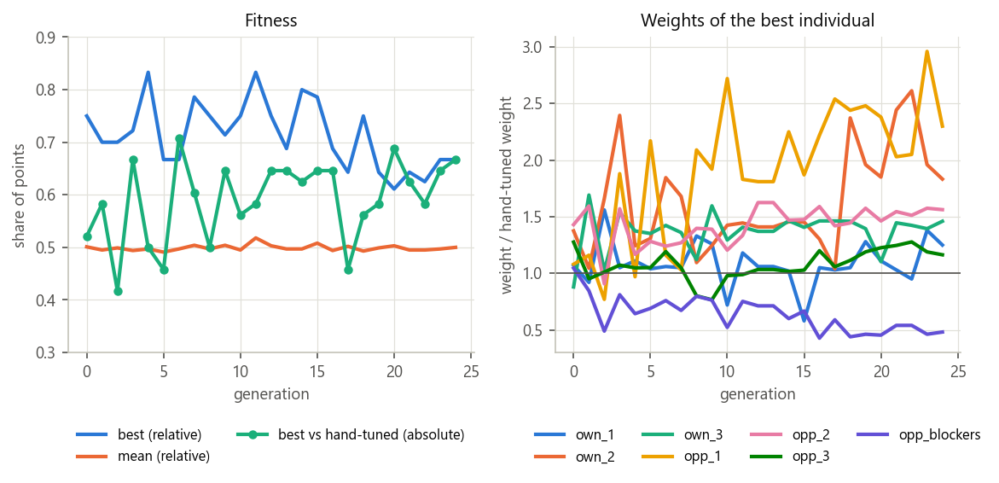

# Practice 1: Connect 6 Game Engine — Project Report

**Course:** Techniques in Artificial Intelligence, MSc in Artificial Intelligence, University of Alicante  
**Author:** Marius Botezatu (practice group 1, worked alone)  
**Engine name:** `mbo`  
**Date:** 8 November 2026  
**Repository:** <https://github.com/botezatumarius/Connect-6-Game-Engine>

## 1. Introduction

Connect6 is a two-player game played on a 19×19 Go board. Black places one stone on the first
move; after that, White and Black alternately place **two** stones per turn. The first player
with six or more stones in a row (horizontally, vertically or diagonally) wins, and the game is
a draw if the board fills up first.

The goal of this practice is a game engine that plays Connect6 with both colours from any
position, answers within a time limit, and communicates with the course GUI (ConnectMore)
through its text protocol. It must use the adversarial search algorithms of Unit 3 with
optimisations that make it work in real time, an evaluation function whose weights are tuned
with machine learning, and an experimental study of the effect of each decision.

The work followed the five sessions of the practice guide. The engine at the end of each
session was kept as a tagged version in Git, so that every stage could be measured in the
experiments:

| Version | Session | Main content |
|---|---|---|
| v1 | 1 | End-of-game detection, naive move proposal and evaluation, fixed-depth Minimax, protocol |
| v2 | 2 | Alpha-beta pruning, incremental board, threat-ranked move proposal, enhanced evaluation |
| v3 | 3 | Detection of imminent threats, weighted feature evaluation with hand-tuned weights |
| v4 | 4 | Weights evolved by a genetic algorithm, iterative deepening under a time limit, forward pruning, transposition table, quiescence search, opening book |
| v5 | 5 | Threat-space search, added after the experiments revealed a weakness (final version) |

Section 2 reviews the state of the art, Section 3 explains and justifies the development,
Section 4 presents the experiments of session 5, and Section 5 concludes.

## 2. State of the art

### 2.1 Connect6 and its complexity

Connect6 was introduced by I-Chen Wu in 2005 as a member of the family of *k-in-a-row* games
Connect(m, n, k, p, q): an m×n board, k stones in a row to win, p stones per move and q stones on
the first move [1, 2]. Connect6 is Connect(19, 19, 6, 2, 1). Wu showed why the two-stone rule
makes the game fair: after every turn, the player who has just moved has exactly one stone more
than the opponent, so neither side keeps a permanent advantage of tempo, unlike Gomoku, where the
first player is known to win [3].

The game is very large. Each of the 361 intersections is empty, black or white, so there are at
most 3³⁶¹ ≈ 10¹⁷² states, the same order as Go. The branching factor is far larger than Go's:
with about 300 empty cells, a two-stone move has about 300·299/2 ≈ 45,000 choices. A full-width
search is therefore impossible, and every successful program restricts the moves it considers.

### 2.2 Threats: the central concept

Strong Connect6 programs reason in terms of **threats**. Wu and Huang [2] define them precisely:
a player has *t* threats when the opponent needs at least *t* stones to stop the player from
winning on the next move. Because a player places two stones per turn, a window of six cells
that holds four or five stones of one player and no opposing stone can be completed in one
move. Consequences used throughout this engine:

- One threat (or two) can be answered: the defender uses one (or both) of its stones to block.
- **Three or more threats cannot be answered with two stones: the attacker wins.**
- A move creating two threats forces the opponent to spend its whole turn defending, so the
  attacker keeps the initiative. Chaining such moves until three threats appear is the basis of
  *threat-space search* [3, 4], called "victory by continuous double threat" in Connect6.

Allis et al. [3] introduced threat-space search to solve Gomoku. Wu and Lin [4] adapted proof
search to Connect6 with *relevance zones*, the regions where the defender's stones can affect an
attack. The ConnectMore GUI used in this practice comes with Cloudict [5], an alpha-beta engine
with a "victory by continuous four" (VCF) threat search, which serves as our reference opponent.

### 2.3 Evaluation of Connect6 positions

Since the search cannot reach the end of the game, positions are scored statically. The usual
approach counts **windows** (or *lines*): every segment of six consecutive cells is a possible
winning line. A window containing stones of only one player is *live* for that player, and a
window with stones of both players is *dead*. Programs weight live windows by the number of
stones they contain, often exponentially, because a window with more stones is closer to six;
names such as "live three" or "dead four" describe the same idea for groups of stones. The guide
of this practice asks for the same two aspects: the size of each live set and the number of
stones the opponent needs to kill it.

The weights of such a linear evaluation function, Σ wᵢ·fᵢ(s), are difficult to set by hand
(Unit 3.3). Machine learning can set them instead: evolutionary methods [6] (Unit 4), regression
on game outcomes, or, in recent programs, neural networks trained by reinforcement learning.

### 2.4 Search algorithms and optimisations

Minimax and its pruned version, alpha-beta [7], are the classical algorithms for two-player,
zero-sum games with perfect information (Unit 3.2). Alpha-beta returns the Minimax value while
examining far fewer nodes; its efficiency depends on the order in which moves are tried. The
optimisations of Unit 3.3 address the real-time constraint of game engines:

- **Iterative deepening:** searching depth 1, 2, 3… gives a move whenever time runs out, and each
  iteration orders the next one.
- **Forward pruning (N-best selective search):** only the N most promising moves, ranked by the
  static evaluation, are searched. This is risky but essential with a branching factor of 45,000.
- **Transposition tables with Zobrist hashing** [8]: the same position, reached by different move
  orders, is searched once. Connect6 has many transpositions, since the two stones of a move,
  and the moves of a sequence, can be placed in any order.
- **Quiescence search:** positions are evaluated only when they are quiet, which avoids the
  horizon effect.
- **History heuristic** [9] and **opening books.**

Monte-Carlo Tree Search [10] has also been applied to k-in-a-row games, but random playouts are
weak at the precise tactics (threats) that decide Connect6, so the strongest programs combine
search with threat-based knowledge.

## 3. Development

### 3.1 Starting point, interface and architecture

The engine started from the course template (`Connect6Engine`), kept its structure (`main.py`,
`game_engine.py`, `search_engine.py`, `defines.py`, `tools.py`) and added one module per
responsibility:

| Module | Responsibility |
|---|---|
| `main.py` | Entry point (also the PyInstaller target). |
| `game_engine.py` | Text protocol: reads commands, keeps the game, prints the answer. |
| `board.py` | Board, rules (win and draw), incremental window statistics, Zobrist hash. |
| `move_generator.py` | Candidate moves: wins, forced defences, ranked candidates. |
| `evaluation.py` | Weighted evaluation function and its features. |
| `search_engine.py` | Alpha-beta search with the optimisations of session 4. |
| `threat_search.py` | Threat-space search for forced wins (session 5). |
| `opening_book.py`, `book_moves.py` | Opening book, looked up through the board symmetries, and its data. |
| `tools.py`, `defines.py` | Move notation, printing, logging; constants. |

Each module depends only on the ones below it (`game_engine` → `search_engine` →
`move_generator`/`evaluation`/`threat_search` → `board` → `defines`), so each part could be
replaced in a later session without touching the others.

**Protocol.** `game_engine.py` implements the 13 commands of the statement with a table that maps
each command to its handler (`vcf`, `unvcf` and unknown commands are ignored, as required). Two
details of the GUI decided the design:

- Every turn the GUI sends `new xxx`, the *whole* history (`black JJJJ`, `white ASBS`, …) and
  `next`. The engine therefore never assumes a colour: after any sequence of `black`/`white`
  commands, the side to move is the opponent of the last colour placed, so the engine plays
  both colours from any position. `move XXXX` places the opponent's stones for the side to move
  and answers; `new black` plays the first move at once.
- `depth d` is used as the time limit: *d* seconds per turn (the GUI levels Low, Medium, High
  send 4, 5 and 6). The limit is capped at 25 s because the GUI forfeits a move after 30 s.

Coordinates follow the GUI: the first letter of a cell is its row and the second its column. The
template printed single-stone moves with the letters swapped, which we fixed. Every answer is
flushed immediately, because the GUI reads through a pipe.

### 3.2 Session 1: a first functional engine

**End of the game.** The first version checked, after each move, the four lines through each of
its (one or two) stones, counting equal stones in both directions; six or more is a win (the
rule says "6 or more", so longer lines win too). Only the last move can create a new line, so
nothing else needs checking. A full board without a winner is a draw. The template's version
returned "no win" as soon as the first stone's cell was empty, without checking the second
stone; ours fixed that.

**Naive move proposal.** Candidates are empty cells, as the guide suggests, limited to avoid the
combinatorial explosion: the 10 empty cells closest (Chebyshev distance ≤ 2) to existing stones,
paired into at most 45 two-stone moves instead of ≈ 45,000. Black's opening move is a single
stone in the centre.

**Naive evaluation.** A finished game scores MAX (black wins), 0 (draw) or MIN (white wins).
Otherwise the score is the number of *living sets* of Black minus those of White, a living set
being a window of six cells containing stones of one colour only. An efficient implementation
splits every line at the opponent's stones: a segment of length L contains L − 5 windows without
opposing stones. The empty windows appear in both counts and cancel, so the difference is
exact. It was checked against a brute-force count on 300 random boards.

**Minimax.** A fixed-depth (2 plies: our move and the reply) Minimax, Black maximising. At the
leaves, or when the game is over, the static evaluation is returned. It was checked against an
independently written Minimax on 15 random positions (identical values).

**Limitations found.** The naive engine lost to Cloudict in 8 turns. Tactical tests showed why:
with a four on the board it did not complete it, and it did not block an opposing four. The
search was correct (with more candidate cells it found the win), but the naive proposal ranked
cells by distance and broke ties by board order, so the decisive cells were never offered.
This motivated the improved move proposal of session 2.

### 3.3 Session 2: alpha-beta, threat-ranked moves and a better evaluation

**Alpha-beta pruning.** Built directly from the Minimax implementation: the maximising player
raises α, the minimising player lowers β, and the remaining moves of a node are skipped as soon
as α ≥ β. The engine counts the expanded nodes and the *pruned* moves (the siblings skipped at
each cut-off). On 20 random positions it returned exactly the same move and score as Minimax,
with 67 % fewer nodes and a third of the time.

**Incremental board.** The improved move proposal and evaluation need, for every one of the 924
windows of the board, the number of black and white stones it contains. Recomputing them at
each node would be too slow in Python, so `board.py` keeps them up to date: placing a stone
updates only the (at most 24) windows through that cell. For each colour the board also keeps
`lines[k]`, the number of live windows holding *k* stones, and `threats`, the set of live
windows holding at least four stones (those the player can complete in one move). A window
reaching six stones sets the winner, which replaces the session 1 line scan. `undo()` reverts
a move exactly, so the search plays and undoes moves on one board instead of copying it. The
refactor gave identical moves, scores and node counts on 27 searches, and made the search
**6 times faster** (0.102 s → 0.017 s per search on the same positions).

**Improved move proposal.** Following the guide, candidates are only the empty cells of live
windows that contain stones ("around the stones that are alive", i.e. that can still form six).
Each cell is scored by the windows that pass through it, for both colours: our windows (attack)
and the opponent's (defence), each weighted by its *severity*, which grows four times with every
stone (1, 4, 16, 64, 256). The 10 best cells are paired and the pairs are ordered from best to
worst by their combined score. With this proposal the engine completed fours, blocked the
opponent's fours, and lasted 9–12 turns against Cloudict instead of 8.

**Enhanced evaluation.** The guide asks to weight live sets by their number of stones and by the
number of stones the opponent needs to kill them. Both are implemented:

1. each live window counts with the severity table (1, 4, 16, 64, 256 for 1–5 stones);
2. for the sets that can win next turn (four or five stones), `Board.blockers()` computes the
   exact number of stones the opponent must place to kill all of them: the size of the minimum
   set of cells that hits every such window (capped at 3, since three cannot be blocked with
   one two-stone move). The kill cost is weighted 128, 1024 or 8192 for 1, 2 or 3 stones.

Smaller sets need no explicit kill cost: an open group lies in many live windows and a blocked
one in few, so counting every live window already weights a group by how hard it is to kill.
`blockers()` was checked against a brute-force minimum hitting set on 61,389 positions
(including 1,932 with two blockers and 300 with three or more). In 8 games against the previous
version (4 openings, both colours) the new evaluation won 5 and drew 3.

### 3.4 Session 3: imminent threats and our own evaluation function

**State of the art.** Section 2 summarises the reading of this session. Its key idea, Wu and
Huang's definition of threats, is exactly what the engine computes with `blockers()`.

**Detecting imminent threats.** The move proposal handles the three cases of the guide in order:

1. **We can win now:** if we have a live window with four or five stones, the only move
   proposed fills it (adding any other stone if one is enough).
2. **The opponent threatens to win next turn:** only moves that block every opponent window
   with four or more stones are proposed: the pairs of candidate cells that intersect the empty
   cells of every such window. If no pair can block them all (three or more blockers), the game
   is lost, and the moves that block the most are proposed.
3. **Otherwise:** moves are ranked by the strength of the threats they create: first by the
   number of stones the opponent would need to stop them (`blockers`), then by the number of
   our windows with four or more stones, then by the cell scores.

Tactical tests (win now, single-gap win, block a four, block two fours at the board edge) all
pass, and a winning move is now found by expanding 2 nodes. Against Cloudict the engine lasted
17–23 turns.

**Our own evaluation function.** The evaluation became a weighted sum of features, so that its
weights can be optimised in session 4. It is computed for the **side to move**, because in
Connect6 the turn is decisive: a player to move with a four on the board simply wins. Two exact
rules are applied first:

- if the side to move has a threat window, it wins with its next move (score just below MAX);
- if the opponent's threats need three or more blockers, the side to move loses.

Otherwise the score is Σ wᵢ·fᵢ over seven features:

| Feature | Meaning | Hand-tuned weight |
|---|---|---|
| own_1, own_2, own_3 | our live sets with 1, 2, 3 stones | 1, 4, 16 |
| opp_1, opp_2, opp_3 | the opponent's live sets with 1, 2, 3 stones | −1, −4, −16 |
| opp_blockers | stones we must spend to stop the opponent's threats (1 or 2) | −128 |

Our sets of four or more never appear in a quiet position (they are a win for the side to move),
and the opponent's appear through `opp_blockers`. The hand-tuned weights were chosen by playing
five candidate weight vectors against the session 2 engine (6 openings, both colours):

| Weights (own_1..3, opp_1..3, opp_blockers) | Games | Wins | Losses | Draws |
|---|---|---|---|---|
| 1, 8, 40, −1, −6, −30, −150 | 12 | 5 | 4 | 3 |
| **1, 4, 16, −1, −4, −16, −128** | **12** | **6** | **2** | **4** |
| 1, 5, 25, −1, −5, −25, −100 | 12 | 5 | 4 | 3 |
| 2, 10, 60, −1, −8, −50, −300 | 11 | 1 | 3 | 7 |
| 1, 6, 36, −1, −6, −36, −500 | 12 | 3 | 5 | 4 |

The selected vector keeps the factor 4 per stone of the severity table. Hand-tuning was slow and
noisy (many draws, few games per vector), which is exactly the problem the genetic algorithm of
session 4 addresses.

### 3.5 Session 4: machine learning and search optimisations

#### 3.5.1 Evolving the evaluation weights with a genetic algorithm

Following the guide and Unit 4, the seven weights of the evaluation function were optimised with
a genetic algorithm (`training/genetic.py`) in which the individuals compete with each other:

| Element | Choice | Reason |
|---|---|---|
| Chromosome | The 7 weights (real numbers) | The evaluation is linear in them. |
| Initial population | 16 individuals: the hand-tuned weights and 15 copies with every weight multiplied by a random log-normal factor (σ = 0.35) | "Around a known configuration established by hand" (guide); multiplying keeps the signs. |
| Fitness | Share of points (win 2, draw 1) in its games of the generation: 4 as black against random individuals, plus those in which other individuals pick it (about 4 as white), from random openings | Competition between the individuals, as the guide proposes (slide 24 of Unit 4). |
| Games | Fixed search depth 2, at most 60 turns (then a draw) | Fast, deterministic and fair: the result depends on the weights, not on the timing. |
| Selection | Tournament of 3 | Moderate selective pressure, robust to noisy fitness. |
| Crossover | Arithmetic: each gene a random blend of the parents' genes | Suited to real-valued genes. |
| Mutation | Each gene, with probability 0.2, multiplied by a log-normal factor (σ = 0.25) | Relative steps fit weights of very different scales (1 to 128). |
| Replacement | Elitism: the 2 best survive unchanged | The best solution is never lost. |
| Termination | 25 generations | About 30 minutes on 8 parallel processes. |
| Validation | The 3 best of the last generation each play the 12 openings with both colours (24 games) against the hand-tuned weights; the best is kept | Fitness inside a generation is relative and noisy. |

The games are played in parallel (`multiprocessing`), and every generation is written to
`training/results/evolution.csv`.

**Results.** Figure 1 shows the run. The best fitness inside a generation *decreases* (from about
0.8 to 0.65) while the weights converge. This is not a loss of quality: fitness is measured
against the other members of the same generation, and as the population becomes homogeneous
nobody can win most of its games. To measure progress in absolute terms, the best individual of
every generation was replayed against the fixed hand-tuned weights (`genetic.py --progress`, 24
games each): the score rises from 0.54 on average over generations 0–4 to 0.64 over generations
20–24. The validated final individual scored **0.73** against the hand-tuned weights (24 games).

*Figure 1: genetic algorithm. Left: best and mean fitness inside each generation (relative) and
score of each generation's best against the hand-tuned weights (absolute). Right: evolution of
the weights of the best individual.*

| Feature | own_1 | own_2 | own_3 | opp_1 | opp_2 | opp_3 | opp_blockers |
|---|---|---|---|---|---|---|---|
| Hand-tuned (session 3) | 1 | 4 | 16 | −1 | −4 | −16 | −128 |
| Evolved (session 4) | 1.12 | 6.97 | 22.74 | −2.49 | −6.25 | −20.60 | −60.50 |

The evolved weights are meaningful. Sets of two and three stones count much more than in the
hand-tuned vector (≈ 7 and ≈ 22 instead of 4 and 16): with its next move a player turns them
into threats. Our sets of three weigh slightly more than the opponent's (22.7 against 20.6),
because we move first, while the opponent's single stones weigh more than ours (2.5 against 1.1),
favouring moves that break up its development early. Finally, the penalty for having to block a
threat is halved (−60 instead of −128): the search answers the threat itself, so the static
penalty was double-counting it. A human would hardly have chosen these values, which is the
point of learning them.

#### 3.5.2 Negamax, iterative deepening and the time limit

The search was rewritten in **negamax** form (Unit 3.2): the evaluation is returned from the point
of view of the side to move and each level negates its children's values, so one procedure
serves both colours and the transposition table can store one kind of score.

**Iterative deepening** searches depth 1, 2, 3… until the time runs out, keeping the move of the
last completed iteration. The time comes from `depth d` (*d* seconds):

- the search stops at **80 %** of the limit (`TIME_SAFETY`), leaving a margin for the protocol;
- no new iteration starts once **25 %** of the limit is spent (`NEXT_ITERATION`): each iteration
  costs several times the previous one, so it could not finish;
- a timeout raises an exception that unwinds the recursion; every `play()` is paired with an
  `undo()` in a `finally` block, so the board is always restored;
- the deadline is enforced even in the first iteration: if nothing has finished, the best root
  move found so far (or the best-ranked candidate) is played;
- wins are scored `MAX − ply`, so a quicker win is preferred and a slower loss chosen when lost.

At a fixed depth, negamax returned the same move as the session 3 Minimax on 40 of 40 positions.
A stress test on 24 positions with limits of 0.2, 0.5, 1 and 2 s, with every search option,
never exceeded the limit: the slowest answer used **82 %** of it.

#### 3.5.3 Forward pruning: N-best selective search

Unit 3.3 describes N-best selective search: rank the candidate moves with the static evaluation
and search only the N best. The move proposal now ranks every candidate pair by the evaluation of
the position it leads to (from the mover's point of view), which already contains the threat
logic of session 3 (a move whose threats cannot be blocked evaluates as a win; a double threat
is worth the opponent's `opp_blockers` penalty). Below the root, only the **10 best** moves are
searched; the root keeps all candidates (12 cells, 66 pairs), so a good move is never discarded
there. Forced defences are never pruned: when the side to move must answer a threat, every
blocking move is searched, because cutting one could hide the refutation of an attack and make a
false win look forced.

With forward pruning the search reached depth 5–6 instead of 4 in the same time, and won a match
of 8 games (2 s per move) against the version without it **5–2, with 1 draw**. Keeping the forced
defences unpruned scored 2 wins and 2 draws, without losses, against a version that pruned them.

#### 3.5.4 Transposition table with Zobrist hashing

Each (colour, cell) pair has a random 64-bit Zobrist key; the board keeps the XOR of the keys of
its stones, updated with one XOR per stone, and a key for the side to move is added. The same
stones placed in another order give the same hash, which is exactly what a transposition is:
in Connect6 the two stones of a move, and the moves of a sequence, can come in any order.

The table maps a hash to the depth searched, the score and whether it is exact, a lower bound
(a cut-off) or an upper bound (all moves failed low), and the best move. This also covers what
the guide calls historical heuristics ("stores the valuations and valuation depth of a given
position"). An entry searched at least as deep settles the node when its bound allows; otherwise
its best move is searched first, so each iteration of the deepening starts with the best line of
the previous one. Win scores are stored relative to the stored position and converted back, so a
transposition found at another ply keeps the right distance to the win. The table is kept
between turns (the next turn searches many of the same positions) and is bounded to 200,000
entries to control the memory; when full it is cleared.

On 12 positions at depth 4 the table returned the same scores with 6 % fewer nodes. The gain inside
one search is small because forward pruning keeps only 10 moves per node, so few transposed
positions are reached; the main benefit is ordering and reuse across iterations and turns.

#### 3.5.5 Quiescence search (implemented, disabled by experiment)

To reduce the horizon effect, the search was extended beyond the depth limit while the side to
move must still answer a threat: such a position is not quiet, so only the forced defences are
searched, for up to 2 or 4 extra plies, before evaluating. The experiments rejected it: with 4
extra plies it **lost all 8 games** against the same engine without it (and 6 of 6 with 2 plies),
and on the test positions it made 1–2 wrong decisions at 0.5–1 s where the plain search made
none. The reason is the cost of Python nodes: the extension uses time that the plain search
spends on one more ply, and the evaluation already scores a pending threat through
`opp_blockers`, so horizon positions are not blind to threats. The extension remains in the code
(`QUIESCENCE`, default 0) and is measured in Section 4.5.

#### 3.5.6 Opening book with board symmetries

The first moves are the most expensive to search (few stones, so many candidate cells of similar
value) and the search is shallow there. `training/build_book.py` builds a book automatically,
with a 30 s search per position: white's reply to black's centre stone, and black's second move
after every white reply with both stones within two cells of the centre.

A position and its 8 symmetric images (4 rotations around the centre and their mirror images)
are the same position, so the book stores each class once, under its *canonical* form: the
smallest of the 8 transformed keys. The 277 positions reduce to **45** searches. At run time,
`opening_book.book_move()` canonicalises the current position, looks it up and maps the stored
move back through the inverse symmetry; this was checked for all 8 orientations. A book move is
played instantly, which also leaves the GUI's clock untouched in the opening.

#### 3.5.7 Robustness of the interface

The statement warns that an engine that does not meet the interface is considered not working.
Every command is therefore executed inside an exception handler: a malformed command (`black`
without cells, a cell outside A–S, a stone on an occupied cell) is logged and ignored, the
engine keeps running and still answers correctly from the next valid history. Moves are checked
before being placed, so a bad command can never corrupt the board statistics.

### 3.6 Session 5: threat-space search, found through testing

The test battery of Section 4.2 showed one failure of v4: in "defend in 2 (black)" it found the
right first defence, but two turns later it allowed Cloudict a double four that needed three
blockers. Replaying the game showed that the losing reply was beyond the depth reached in the
available time (3 plies), while 192 of the 1,128 candidate moves would have been safe. The
remedy is the technique of the state of the art (Section 2.2): a **threat-space search**
(`engine/threat_search.py`), which follows only moves that create threats. Because every threat
forces the opponent to block it, the tree is very narrow and wins far beyond the full-width
horizon can be proved. The search is exact for wins within three turns: a defending stone only
matters where it blocks a threat or a future four, i.e. in a window holding at least two of the
attacker's stones, so those cells (or a stone elsewhere, which changes nothing) are the only
defences to try. The engine uses it twice per turn, within the same time limit:

1. **Attack (before the alpha-beta search, 15 % of the time):** if a forced win within 2, then 3
   turns exists, it is played at once. The shorter horizon is tried first, so the engine always
   takes the quickest win: a first version that searched 3 turns directly sometimes chose a
   3-turn win when a 2-turn win existed.
2. **Safety (after the search, up to 90 % of the time):** if the chosen move lets the opponent win
   by threats within 2 turns, the next root moves (in the order of the last iteration) are tried
   until a safe one is found; checking one move takes about 16 ms.

The same module now also certifies the test positions of the experiments, so the engine and the
experiments share a single implementation. The final engine solves all 12 positions of the
battery, never exceeded the time limit in the stress test (slowest move: 80 % of the limit), and
beat v4 in the final tournament (Section 4.4).

### 3.7 CPU, memory and code quality

The statement asks to take the CPU and RAM consumption into account. The main decisions were:

- **CPU.** The incremental board updates at most 24 windows per stone instead of rescanning the
  board (6 times faster search); the threat sets are maintained, not searched; the evaluation
  only reads counters (≈ 1 µs); the search plays and undoes moves on a single board instead of
  copying it; forward pruning limits the branching factor; the board's hot loop uses local
  names. The engine runs on one core.
- **Memory.** The board is a flat list of 361 cells plus, per colour, one counter per window
  (2 × 924 integers). The transposition table is the only structure that grows, and it is
  bounded (200,000 entries; Section 4.6 measures it). The opening book holds 45 entries.
- **Code.** Each module has one responsibility and depends only on lower ones; constants live in
  `defines.py`; every module, class and function has a docstring and each step of the
  algorithms a short comment, as the statement requires. The repository holds only course
  material: the engine, the training and experiment scripts with their results, the report and
  the unchanged GUI.
- **Version control.** Git was used from the first session (repository linked on the title
  page). Each guide item is one commit, and the engine at the end of each session is tagged
  (`session-1` … `session-5`), which is what made it possible to measure every version in
  Section 4.

